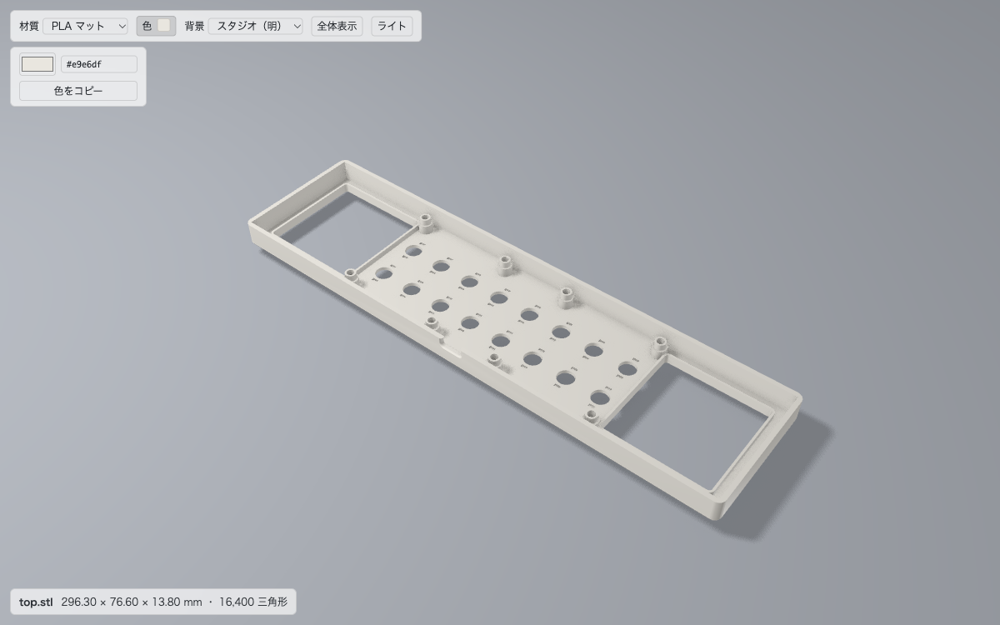
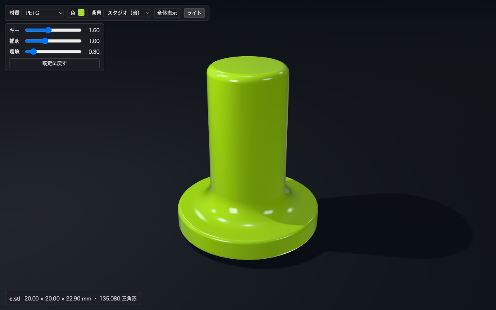

# JP STL Viewer

---

## 目次

- [機能](#機能)
- [使い方](#使い方)
- [設定](#設定)
- [色付きの STL について](#色付きの-stl-について)
- [画面](#画面)
- [ライセンス](#ライセンス)

---

STL ファイルを **リアルタイム PBR** で高品位にプレビューする VSCode 拡張。`.stl` を開くとこのビューアで表示され、ファイルが書き換わると**視点を保ったまま自動で再読込**する。CAD やスクリプトで形を作りながら、3D プリントしたときの見え方を横で確かめられる。

## 機能

- **PBR 描画**: 環境光（IBL）＋影付きのキーライト＋床下からの補助光、ソフトシャドウ、アンビエントオクルージョン（隅や接地部の陰り）、アンチエイリアス
- **材質プリセット**: PLA マット / PLA / PLA シルク / PETG / PETG クリア / レジン / カーボン入り / アルミ ＋ 色ピッカー
- **ライトの調整**: 「ライト」でキー・補助・環境光の強さをスライダーで変えられる（「既定に戻す」あり）
- **背景**: スタジオ（明）/ スタジオ（暗）
- **自動リロード**: STL が書き換わると、書き込みが終わるのを待ってから読み直す
- **滑らかな陰影**: 設定した角度未満で接する面は滑らかに、それ以上は折れ目としてシャープに描く
- **寸法表示**: 外寸（X × Y × Z, mm）と三角形数を表示。STL の Z 軸を上向きとして表示する
- **STL の色**: バイナリ STL に色が埋め込まれていればその色で塗る。STL の中の色ごとに、表示する色を変えることもできる（STL ファイルは書き換えない）
- **色のコピー**: ファイル名と色（16 進・RGB）をテキストでクリップボードにコピーできる
- **見た目の記憶**: 材質・色はファイルごとに、背景とライトは全体で覚える

## 使い方

- エクスプローラで `.stl` を開く。またはコマンドパレット / エクスプローラの右クリックで `JP STL Viewer: STL をプレビューで開く`
- 左ドラッグで回転、右ドラッグでパン、ホイールでズーム、`F` または「全体表示」で視点を戻す
- 「色」を押すと、色ピッカー・16 進の入力欄・「STL の色を使う」・「色をコピー」が開く
  - 色付きの STL では、STL の中の色が表面積の多い順に並び、1 色ずつ変えたり元に戻したり（↺）できる
  - 「色をコピー」は、変えた色があれば「元の色 → 新しい色」の一覧を、無ければ色の一覧をコピーする

`.stl` を別の拡張で開いてしまう場合は、STL を右クリック →「Open With…」→「JP STL Viewer」→「Configure default editor」で切り替える。

## 設定

| 設定 | 既定値 | 説明 |
|---|---|---|
| `jpstlviewer.creaseAngle` | `30` | この角度（度）未満で接する面どうしは滑らかに陰影を付ける。0 で STL どおりのフラット陰影 |
| `jpstlviewer.floatRatio` | `0.05` | モデルを床から浮かせる量（外接球の半径に対する割合）。0 で接地 |

## 色付きの STL について

STL の色は正式な規格ではない。この拡張は、多くのツールが使うバイナリ STL の慣習（ヘッダの `COLOR=` と、三角形ごとの 15 ビット色）に対応している。ヘッダに `COLOR=` が無いファイルは色なしとして扱う。ASCII STL には色を入れられない。

## 画面

## ライセンス

MIT。同梱している three.js（MIT）の著作権表示は [ThirdPartyNotices.txt](ThirdPartyNotices.txt) に載せている。

開発・ビルドの情報は [docs/development.md](docs/development.md) を参照。
