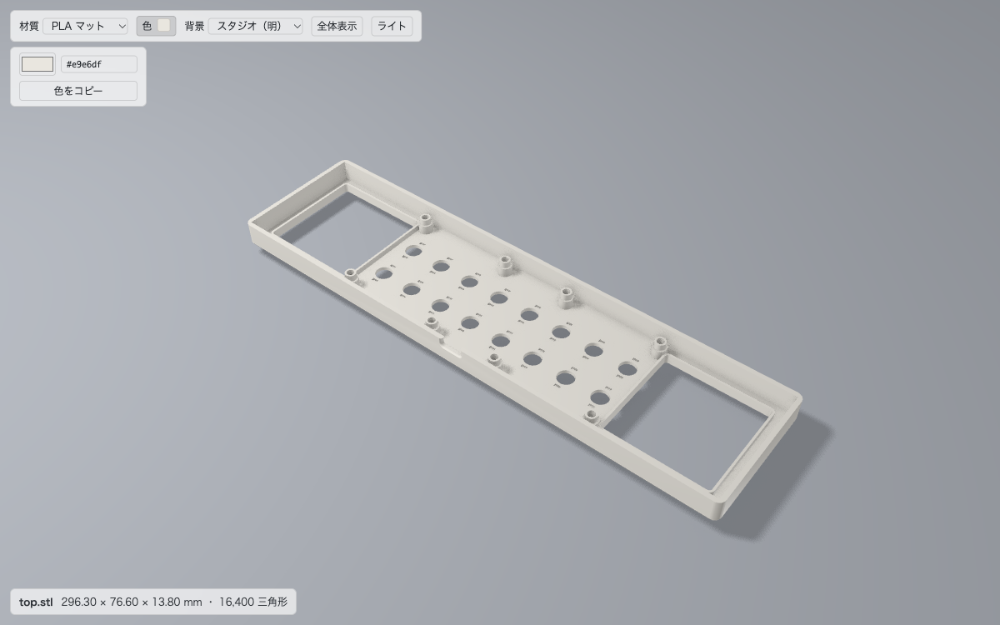
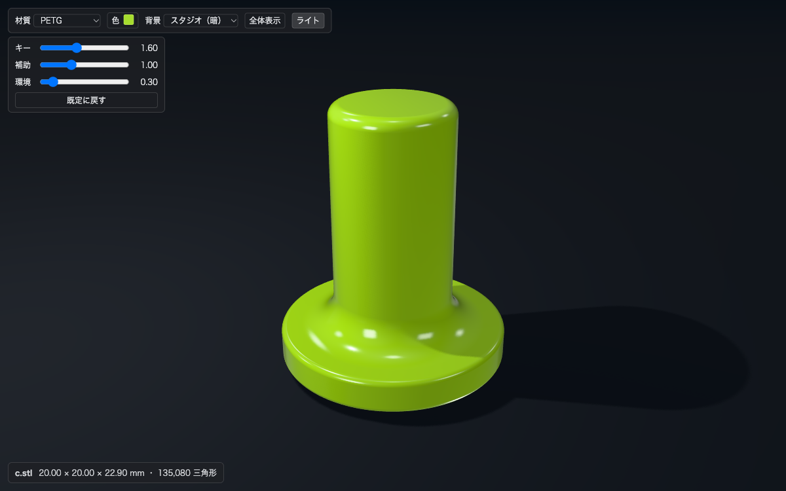

# JP STL Viewer

---

## 目次

- [機能](#機能)
- [使い方](#使い方)
- [設定](#設定)
- [色付きの STL について](#色付きの-stl-について)
- [3MF について](#3mf-について)
- [KiCad 基板（.kicad_pcb）について](#kicad-基板kicad_pcbについて)
- [画面](#画面)
- [ライセンス](#ライセンス)

---

STL / 3MF / KiCad 基板ファイルを **リアルタイム PBR** で高品位にプレビューする VSCode 拡張です。`.stl` / `.3mf` を開くとこのビューアで表示され、ファイルが書き換わると**視点を保ったまま自動で再読込**します。CAD やスクリプトで形を作りながら、3D プリントしたときの見え方を横で確かめられます。

## 機能

- **PBR 描画**: 環境光（IBL）＋影付きのキーライト＋床下からの補助光＋カメラに付けた弱い光、ソフトシャドウ、アンビエントオクルージョン（隅や接地部の陰り）、アンチエイリアス
- **材質プリセット**: PLA マット / PLA / PLA シルク / PETG / PETG クリア / レジン / カーボン入り / アルミ ＋ 色ピッカー
- **ライトの調整**: 「ライト」でキー・補助・環境光・カメラの光の強さをスライダーで変えられます（「既定に戻す」あり）
- **背景**: スタジオ（明）/ スタジオ（暗）
- **自動リロード**: ファイルが書き換わると、書き込みが終わるのを待ってから読み直します
- **滑らかな陰影**: 設定した角度未満で接する面は滑らかに、それ以上は折れ目としてシャープに描きます
- **寸法表示**: 外寸（X × Y × Z, mm）と三角形数を表示します。ファイルの Z 軸を上向きとして表示します
- **長さの計測**: モデル上の 2 点をクリックすると、その間の長さを定規の目盛り付きの線で表示します。目盛りは見えている大きさに合わせて 1 mm / 10 mm / 100 mm ごとに切り替わり、5 目盛りごと・10 目盛りごとに太く長くなります
- **ファイルの色**: バイナリ STL の色や、3MF のフィラメント・材質の色があればその色で塗ります。ファイルの中の色ごとに、表示する色を変えることもできます（ファイルは書き換えません）
- **色のコピー**: ファイル名と色（16 進・RGB）をテキストでクリップボードにコピーできます
- **KiCad 基板**: `.kicad_pcb` を kicad-cli で書き出して、基板と部品を 3D でプレビューします（KiCad 8 以降が必要）
- **見た目の記憶**: 材質・色はファイルごとに、背景とライトは全体で覚えます

## 使い方

- エクスプローラで `.stl` / `.3mf` を開きます。またはコマンドパレット / エクスプローラの右クリックで `JP STL Viewer: STL / 3MF / KiCad 基板をプレビューで開く` を選びます（`.kicad_pcb` は下の「KiCad 基板」の節を参照）
- 左ドラッグで回転（裏返しても止まらず、どの向きにも回せます）、右ドラッグでパン、ホイールでズーム、`F` または「全体表示」で視点を戻します
- 「計測」または `M` で計測モードにして、モデル上を 2 回クリックすると長さを測れます
  - 線の横に長さ（mm）と、X / Y / Z 方向それぞれの差を表示します。何本でも続けて測れます
  - クリックした位置の近くに頂点があれば、その頂点に吸着します。`Alt`（`Option`）を押しながらクリックすると吸着しません
  - 計測モードでもドラッグで回転・パンできます（押してから離すまでほとんど動かさなかったときだけクリックとみなします）
  - `Esc` で置きかけの 1 点目を取り消し、もう一度押すと計測の線をすべて消します（「計測を消す」でも消せます）。ファイルの再読込では線を残します
- 「色」を押すと、色ピッカー・16 進の入力欄・「ファイルの色を使う」・「色をコピー」が開きます
  - 色付きのファイルでは、ファイルの中の色が表面積の多い順に並び、1 色ずつ変えたり元に戻したり（↺）できます
  - 「色をコピー」は、変えた色があれば「元の色 → 新しい色」の一覧を、無ければ色の一覧をコピーします

`.stl` / `.3mf` を別の拡張で開いてしまう場合は、ファイルを右クリック →「Open With…」→「JP STL Viewer」→「Configure default editor」で切り替えます。

## 設定

| 設定 | 既定値 | 説明 |
|---|---|---|
| `jpstlviewer.creaseAngle` | `30` | この角度（度）未満で接する面どうしは滑らかに陰影を付けます。0 でファイルどおりのフラット陰影になります |
| `jpstlviewer.floatRatio` | `0.05` | モデルを床から浮かせる量（外接球の半径に対する割合）。0 で接地します |
| `jpstlviewer.kicadCliPath` | 空 | kicad-cli のパス。空なら PATH と KiCad の標準のインストール先から探します |
| `jpstlviewer.periodicRedraw` | `true` | 10 秒ごとに描き直します（3D が白いまま戻らない不具合の対策）。動作の記録は出力パネルの「JP STL Viewer」に出ます |

## 色付きの STL について

STL の色は正式な規格ではありません。この拡張は、多くのツールが使うバイナリ STL の慣習（ヘッダの `COLOR=` と、三角形ごとの 15 ビット色）に対応しています。ヘッダに `COLOR=` が無いファイルは色なしとして扱います。ASCII STL には色を入れられません。

## 3MF について

- ファイルに入っているオブジェクトを、配置（ビルドの位置・回転）どおりに 1 つの形にまとめて表示します。Bambu Studio などで複数のプレートに並べたファイルは、全プレート分が並んで見えます
- 別ファイルに分けた部品（Bambu Studio / OrcaSlicer が使う Production 拡張の `p:path`）も読みます
- 形ではないもの（3MF の `type` が `support` などのオブジェクト、Bambu Studio / OrcaSlicer のモディファイア・負の体積など）と、「印刷しない」にしたオブジェクトは描きません。PrusaSlicer のモディファイアは見分けられず、形として描きます
- 色は次の順で決めます
  1. Bambu Studio / OrcaSlicer の 3MF: オブジェクト・部品に割り当てたフィラメントの色（3MF の材質より優先します）
  2. それ以外: 3MF の材質（`basematerials` の `displaycolor`、`colorgroup` の色）。色の無い面は灰色で表示します
- スライサーの「塗り分け（ペイント）」の色には対応していません

## KiCad 基板（.kicad_pcb）について

- KiCad 8 以降が必要です。拡張が KiCad 付属の `kicad-cli` で基板を GLB に書き出し、その結果を表示します。書き出しは KiCad 9 以降なら全部入り（パターン・パッド・ベタ・シルク・レジスト）で、基板によっては約 10 秒かかります。KiCad 8 ではパッド・シルク・レジストは入らず（9 以降で入る）、パターンとベタだけです。書き出し中は前の表示を残し、下の帯に状態を出します
- 書き出したファイルは一時フォルダに置き、読み終えたら消します。KiCad などで基板を保存すると、書き出し直して視点を保ったまま表示を更新します
- 書き出した結果は拡張の保存場所に最近の 20 枚まで残し、基板が変わっていなければ次からは書き出さずにすぐ開きます。書き出し中は下の帯に経過秒数と、前回その基板にかかった時間を目安にした進み具合のバーを出します（KiCad は途中経過を出さないので、バーは見込みです）
- ダブルクリックでは今までどおりテキストで開きます。プレビューは、`.kicad_pcb` を右クリック →「JP STL Viewer: STL / 3MF / KiCad 基板をプレビューで開く」、または「Open With…」→「JP STL Viewer（KiCad 基板）」で開きます
- 「層」ボタンで、部品・シルク・レジスト・銅（内層も）・基板・穴・ビアを表示・非表示にできます。隠した層は基板ごとに覚えます。内層は KiCad 9 以降で書き出され、内層の多い大きな基板は書き出しに数分かかることがあります
- プレビュー画面の「KiCad で開く」ボタン、またはエクスプローラの右クリック →「KiCad で開く」で、その基板を KiCad で開きます
- KiCad が見つからないときは、インストールを案内してダウンロードページを開くボタンを出します。`kicad-cli` が標準の場所に無いときは、設定 `jpstlviewer.kicadCliPath` にパスを指定します
- 色や材質プリセットの扱いは 3MF と同じです。GLB の色はそのまま使いますが、金属感は再現せず、全体に 1 つの材質プリセットを当てます。レジストは半透明で重ね、濃さは「ライト」のパネルの「レジストの濃さ」で変えられます（既定 0.6。全ファイル共通で覚えます）

## 画面

## ライセンス

MIT です。同梱している three.js（MIT）の著作権表示は [ThirdPartyNotices.txt](ThirdPartyNotices.txt) に載せています。

開発・ビルドの情報は [docs/development.md](docs/development.md) を参照してください。
