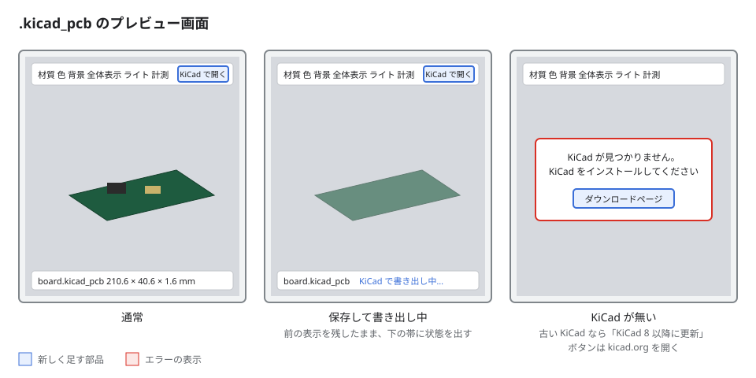

# 実装計画-kicad_pcb

## 変更履歴

| 日付 | 変更者 | 変更内容 |
| --- | --- | --- |
| 2026-11-12 | Junpei Wada | 全フェーズの実装とレビュー指摘の修正を終え、KiCad 8 ではパッド・シルク・レジストを含めない形にした。 |
| 2026-11-12 | Junpei Wada | フェーズ4を完了し、P1-1・P2-1・P2-3 を終えた。 |
| 2026-11-12 | Junpei Wada | 初版作成。GLB 読み込み・kicad-cli 書き出し・画面・文書の 4 フェーズに分けた。 |

## 概要

`.kicad_pcb` を、拡張から kicad-cli で GLB（glTF バイナリ）に書き出してプレビューする。GLB の全メッシュを 1 つにまとめ、材質の色を三角形ごとの色にして 3MF と同じ流れ（色の置き換え・計測・材質プリセット）に乗せる。

- **対象**: `.kicad_pcb` のプレビュー、KiCad が無いときの案内、「KiCad で開く」
- **やらないこと**: GLB の材質の金属感・半透明の再現（全体を 1 つの材質プリセットで塗る）。`.kicad_pcb` を自前で解釈すること。`.glb` 単体をプレビューの対象にすること。ダブルクリックで開く既定の動きを変えること（テキストのまま）
- **関連**: [相談資料](../temp/consult/kicad_pcb/consult.md)（git 管理外）

### 決めたこと

- 書き出しは全部入り（KiCad 9 以降。8 には `--include-pads` `--include-silkscreen` `--include-soldermask` が無いので付けない）: `kicad-cli pcb export glb -f --include-tracks --include-pads --include-zones --include-silkscreen --include-soldermask -o <一時ファイル> <pcb>`（手元の基板で約 11 秒・14MB・32 万三角形）
- kicad-cli の探し方: 設定 `jpstlviewer.kicadCliPath` → PATH の `kicad-cli` → `/Applications/KiCad/KiCad.app/Contents/MacOS/kicad-cli` → Windows の `C:\Program Files\KiCad\*\bin\kicad-cli.exe`
- 見つからないときは「KiCad をインストールしてください」と kicad.org のダウンロードページを開くボタン。`kicad-cli version` が 8 未満なら「KiCad 8 以降に更新してください」
- `.kicad_pcb` 用のカスタムエディタは priority `option`。右クリックの「プレビューで開く」と「KiCad で開く」、プレビュー画面の「KiCad で開く」ボタンを用意する
- GLB は**単位がメートル・Y 上向き**（手元で確認）。読むときに mm・Z 上向きへ直し、以降は STL / 3MF と同じ処理に渡す
- GLB は自前の同期パーサで読む（GLTFLoader は非同期で、今の同期の読み込みと再読込の順序制御を崩すため使わない）

### 約束（タスクをまたいで使う形）

- `src/webview/glb.ts`: `isGlb(data: Uint8Array): boolean`（先頭 4 バイトが `glTF`）、`parseGlb(data: Uint8Array): ThreeMfMesh`（`threemf.ts` の型をそのまま使う。positions は非インデックス・mm・Z 上向き、colors は `#rrggbb` の sRGB）
- 拡張 → webview:
  - `init` に `isPcb: boolean` を足す
  - `{ type: 'status', message: string }`: 下の帯に出す状態（空文字で消す）
  - `{ type: 'kicadMissing', reason: 'notFound' | 'tooOld', version?: string }`: KiCad の案内を出す
- webview → 拡張: `{ type: 'openKicadDownload' }` と `{ type: 'openInKicad' }`
- `src/kicad.ts`: `findKicadCli(configured: string): Promise<{ path: string; version: string } | { missing: 'notFound' | 'tooOld'; version?: string }>`、`exportGlb(cli: string, pcb: string, signal: AbortSignal): Promise<Uint8Array>`（失敗時は stderr を含む Error）、`openInKicad(cli: string | undefined, pcb: string): Promise<void>`

## 進捗

**現在**: 全フェーズの実装を完了（次の一手: 目視確認）

| フェーズ | 状態 | 完了 | 備考 |
| --- | --- | --- | --- |
| 1. GLB の読み込み | ✅ 完了 | 2/2 | — |
| 2. kicad-cli での書き出し | ✅ 完了 | 3/3 | 目視確認が残る |
| 3. 画面 | ✅ 完了 | 1/1 | 目視確認が残る |
| 4. 文書 | ✅ 完了 | 1/1 | — |

> 状態: ⬜ 未着手 / 🔄 進行中 / ✅ 完了 / ⏸️ 保留。タスクは `- [ ]` / `- [x]`。
> フェーズ内の全タスクが `- [x]` になったら ✅ にする。備考は1行まで（詳細は各フェーズ本文へ）。
> タスクの「触る」は書き換えるファイルを全部（宣言・登録・索引への追記も含む）、「依存」は先に終わっている必要があるタスク ID。

### 更新のきまり

- 更新は実装したターン内で行う（「動いた＝更新済み」と錯覚しない）
- **状態はこの表だけに書く**。フェーズ見出しには書かない
- 変更履歴は**新しい行を上に**足す。1行1文
- 計画とズレたら計画側を直し、変更履歴に残す

---

## フェーズ1: GLB の読み込み

**目標**: GLB のバイト列を、三角形ごとの色つきの 1 メッシュ（mm・Z 上向き）として表示できる。

### タスク

- [x] **P1-1**: `src/webview/glb.ts` を作る。GLB のヘッダ・JSON チャンク・BIN チャンクを読み、シーンのノードを親から順にたどって TRS / `matrix` を掛け合わせ、mode 4（三角形）のプリミティブをすべてワールド座標の非インデックス三角形にする。インデックスは u8 / u16 / u32、`byteStride` に対応する。材質の `baseColorFactor`（リニア）を sRGB の `#rrggbb` に直して色の一覧にし、三角形ごとの番号を付ける。最後にメートル → mm（×1000）、Y 上向き → Z 上向き（`(x, y, z) → (x, -z, y)`）に直す（触る: `src/webview/glb.ts`／依存: なし）
- [x] **P1-2**: `src/webview/main.ts` の `parseModel` で、`isZip` より前に `isGlb` を判定して `parseGlb` を使う。冒頭のコメントと `stlHasColors` の説明に GLB を足す（触る: `src/webview/main.ts`／依存: P1-1）

### 完了確認

```bash
npm run compile
# 期待: エラーなしで終わる
T=$(mktemp -d) && kicad-cli pcb export glb -f -o $T/a.glb ../ESP32Test/projects/JP-MIDIKey13-v2/pcb/jp-midikey13-v2/jp-midikey13-v2.kicad_pcb >/dev/null 2>&1 \
  && npx esbuild src/webview/glb.ts --bundle --platform=node --format=cjs --outfile=$T/glb.cjs --log-level=error \
  && node -e 'const g=require(process.argv[1]);const m=g.parseGlb(new Uint8Array(require("fs").readFileSync(process.argv[2])));
const p=m.positions,mn=[1e9,1e9,1e9],mx=[-1e9,-1e9,-1e9];for(let i=0;i<p.length;i++){mn[i%3]=Math.min(mn[i%3],p[i]);mx[i%3]=Math.max(mx[i%3],p[i]);}
console.log("三角形",p.length/9,"色",m.colors&&m.colors.length,"寸法",mx.map((v,i)=>(v-mn[i]).toFixed(1)).join(" x "));' $T/glb.cjs $T/a.glb
# 期待: 三角形 23392、色 4 以上、寸法の X が 200〜220・Y が 35〜50・Z が 1.5〜30（mm。Z が最も小さい板の厚み方向）
```

---

## フェーズ2: kicad-cli での書き出し

**目標**: `.kicad_pcb` を右クリック → プレビューで開くと、書き出した GLB が表示され、保存すると書き出し直される。

### タスク

- [x] **P2-1**: `src/kicad.ts` を作る（約束のとおり）。`findKicadCli` は決めた順に探し、`kicad-cli version` の主番号が 8 未満なら `tooOld`。`exportGlb` は `fs.mkdtemp(os.tmpdir())` の中に書き出して読み、フォルダごと消す。`signal` で中断されたら子プロセスを kill する。`openInKicad` は kicad-cli の隣の pcbnew（macOS は `KiCad.app/Contents/Applications/pcbnew.app`、Windows は `bin/pcbnew.exe`）で開き、無ければ OS の既定アプリ（`open` / `start` / `xdg-open`）で開く（触る: `src/kicad.ts`／依存: なし）
- [x] **P2-2**: `src/extension.ts` に `.kicad_pcb` の流れを入れる。`send` は拡張子が `.kicad_pcb` なら `readFile` の代わりに `exportGlb` を使い（`isCompleteFile` は使わない）、書き出しの前に `status`「KiCad で書き出し中…」、後に空の `status` を送る。新しい保存が来たら書き出し中のものを中断する。失敗したら 1 回だけ間を置いて書き出し直し（保存の途中を読んだ場合）、それでも失敗なら stderr を `error` と出力パネルに出す。kicad-cli が無い・古いときは `kicadMissing` を送る。`init` に `isPcb` を足す。`openKicadDownload`（`https://www.kicad.org/download/` を `vscode.env.openExternal`）と `openInKicad` を受ける。カスタムエディタ `jpstlviewer.pcbPreview` を同じ provider で登録し、コマンド `jpstlviewer.openInKicad` を足し、`jpstlviewer.open` は `.kicad_pcb` なら `jpstlviewer.pcbPreview` で開く。設定 `jpstlviewer.kicadCliPath` が変わったら探し直す（触る: `src/extension.ts`／依存: P2-1）
- [x] **P2-3**: `package.json` の `contributes` に足す。カスタムエディタ `jpstlviewer.pcbPreview`（表示名「JP STL Viewer（KiCad 基板）」、`*.kicad_pcb`、priority `option`）、コマンド `jpstlviewer.openInKicad`（「KiCad で開く」）、エクスプローラの右クリックに `.kicad_pcb` 用の「プレビューで開く」と「KiCad で開く」、設定 `jpstlviewer.kicadCliPath`（文字列・既定は空・空なら自動で探す）（触る: `package.json`／依存: なし）

### 完了確認

```bash
npm run compile
# 期待: エラーなしで終わる
node -e 'const p=require("./package.json").contributes;console.log(p.customEditors.map(e=>e.viewType+":"+e.priority).join(","),!!p.configuration.properties["jpstlviewer.kicadCliPath"])'
# 期待: jpstlviewer.preview:default,jpstlviewer.pcbPreview:option true
```

- [ ] `.kicad_pcb` を右クリック →「プレビューで開く」で基板と部品が表示され、ダブルクリックはテキストのまま開く（目視）
- [ ] KiCad で保存すると、視点を保ったまま書き出し直される（目視）

---

## フェーズ3: 画面

**目標**: 書き出し中・KiCad が無いときの表示と「KiCad で開く」ボタンが、画面イメージのとおりに出る。

**画面**:



「KiCad で開く」はツールバーの右端で `.kicad_pcb` のときだけ出し、書き出し中は前の表示を残して下の帯に状態を出す。

### タスク

- [x] **P3-1**: `src/webview/main.ts` と `media/webview.css` に画面を足す。ツールバーの右端に「KiCad で開く」（`init.isPcb` のときだけ出し、押すと `openInKicad` を送る）。下の帯に `#status`（`status` を受けて出す・消す）。`kicadMissing` を受けたら中央に案内（`notFound`: 「KiCad が見つかりません。KiCad をインストールしてください」、`tooOld`: 「KiCad <version> は GLB を書き出せません。KiCad 8 以降に更新してください」）とダウンロードページのボタン（押すと `openKicadDownload`）。読み込みが成功したら案内を消す（触る: `src/webview/main.ts`, `media/webview.css`／依存: P1-2）

### 完了確認

```bash
npm run compile
# 期待: エラーなしで終わる
```

- [ ] 画面イメージと同じ配置になる（目視）
- [ ] 設定 `jpstlviewer.kicadCliPath` に存在しないパスを入れ、PATH からも見つからない状態で開くと案内が出て、ボタンで kicad.org が開く（目視）
- [ ] 「KiCad で開く」で KiCad の PCB エディタが開く（目視）

---

## フェーズ4: 文書

**目標**: README・開発メモ・拡張の説明に KiCad 基板の対応が書かれている。

### タスク

- [x] **P4-1**: `README.md` に `.kicad_pcb` のプレビュー（KiCad 8 以降が必要、開き方、設定 `jpstlviewer.kicadCliPath`）を足す。`docs/development.md` の設計メモに「KiCad 基板の読み方」（kicad-cli で GLB へ書き出す、単位と向きの変換、1 メッシュ化）を足し、目次も直す。`package.json` の `description` と `keywords`（`kicad`, `pcb`）を直す（触る: `README.md`, `docs/development.md`, `package.json`／依存: P2-3）

### 完了確認

```bash
grep -c "kicad_pcb" README.md docs/development.md
# 期待: どちらも 1 以上
node -e 'const p=require("./package.json");console.log(p.keywords.includes("kicad"),/KiCad/.test(p.description))'
# 期待: true true
```

---

## 全体の完了基準

- [ ] `.kicad_pcb` をプレビューで開くと基板と部品が表示され、色の置き換え・計測・材質プリセットが使える（目視）
- [ ] `npm run compile` がエラーなしで通る

## 注意点

- 書き出しは 10 秒ほどかかる。続けて保存したとき、古い書き出しの結果が新しい結果を上書きしないよう、中断と世代の確認（既存の `generation`）を両方効かせる
- 見た目の記憶（`saveLook`）と視点の記憶（`ViewState.bytes`）はそのまま使う。GLB の長さは書き出しのたびに少し変わり得るので、計測の線が消えることがある（許容）
- GLB の材質の色はリニア。sRGB に直さずに `#rrggbb` にすると、`applyStlColors` の `Color.set` で二重にリニア化されて暗くなる

## 並列実行の割り振り

| 波 | レーン | タスク | 書き込み先 |
| --- | --- | --- | --- |
| 1 | A | P1-1 | src/webview/glb.ts |
| 1 | B | P2-1 | src/kicad.ts |
| 1 | C | P2-3, P4-1 | package.json, README.md, docs/development.md |
| 2 | A | P1-2, P3-1 | src/webview/main.ts, media/webview.css |
| 2 | B | P2-2 | src/extension.ts |
